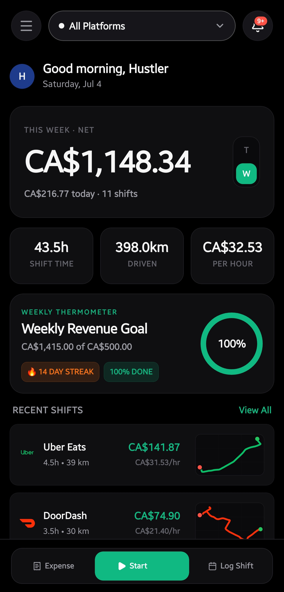
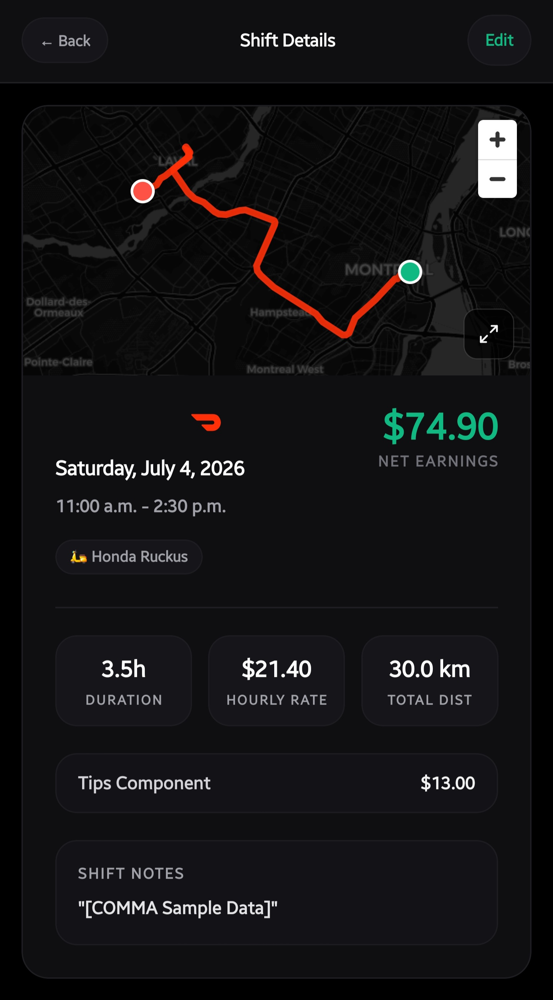
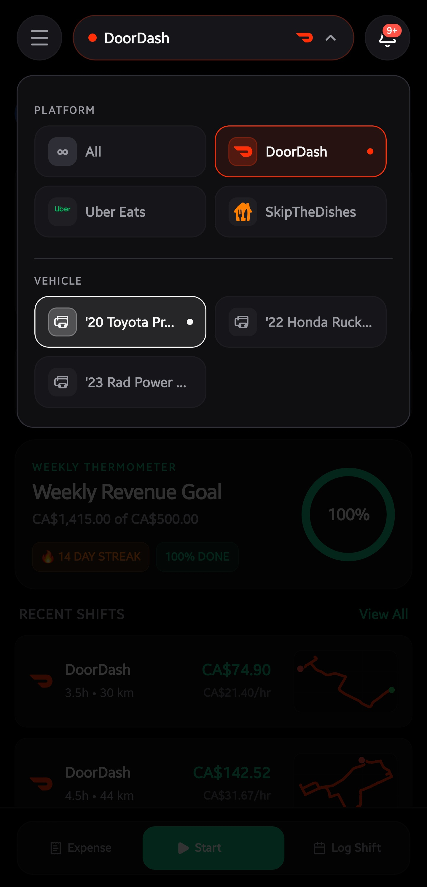
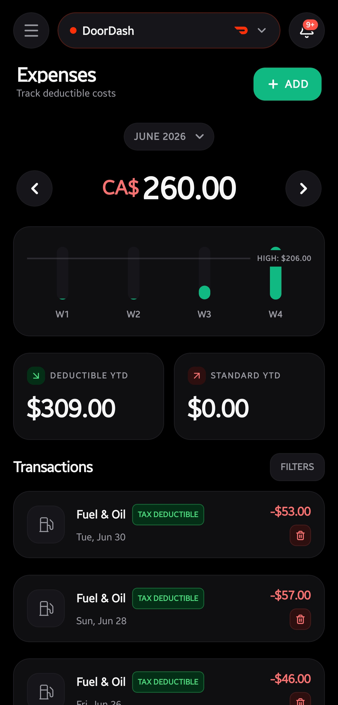
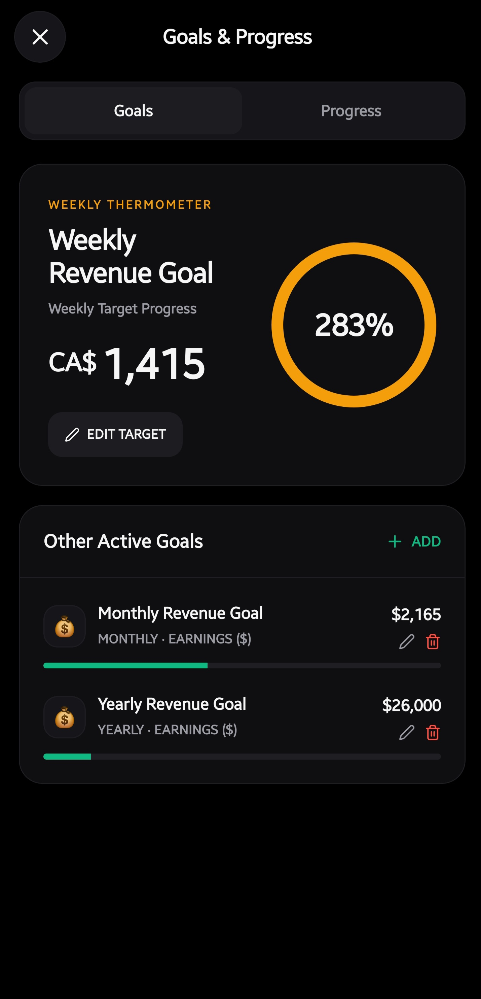
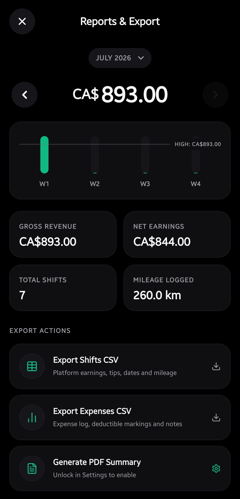

> [!IMPORTANT]
> **Comma is retired.** It is no longer developed, and no new features or fixes are planned.
> Its successor is **[MileWage](https://github.com/raiz-toff/Milewage)**, where all new work goes.
>
> The two are different apps, and MileWage is not a drop-in upgrade:
>
> - **Comma** keeps everything on the phone, with no account and no server.
> - **MileWage** is self-hosted: the phone records the shift, and a server you run yourself
>   (a home server or Raspberry Pi, reached over Tailscale) keeps the data.
> - **There is no migration.** MileWage does not import Comma data; moving means starting fresh.
>
> If "no server" is what you want, staying on Comma as it is remains a reasonable choice. The
> [final release](https://github.com/raiz-toff/CommaApp/releases/latest) stays available to download.

<p align="center">
  
</p>

# Comma

[](https://github.com/raiz-toff/CommaApp/releases/latest)
[](LICENSE)

Android earnings tracker for gig drivers in Canada. Tracks shifts, mileage, expenses, and gives tax estimates. Everything stays on your phone — no account, no cloud unless you want it.

Built for DoorDash, Uber Eats, SkipTheDishes, Instacart, Amazon Flex, and others.

**[Download for Android](https://github.com/raiz-toff/CommaApp/releases/latest)** · **[Privacy policy](https://comma-docs.vercel.app/privacy)**

## What's in this repository

Comma ended in three forms, each kept on its own branch:

| Branch | What it holds |
|---|---|
| [`main`](https://github.com/raiz-toff/CommaApp/tree/main) | The full Comma: the React Native Android app, the web app and the docs site. Released as v1.5.0. |
| [`feat/android-only`](https://github.com/raiz-toff/CommaApp/tree/feat/android-only) | Comma cut down to a smaller Android-only app: no web app, docs site or gamification. Never released. |
| [`native-android`](https://github.com/raiz-toff/CommaApp/tree/native-android) | **Comma Simple**, a rewrite in Kotlin and Jetpack Compose that does only the essentials: shifts with GPS distance, expenses, reports and Google Drive backup. The code is in [`native/`](https://github.com/raiz-toff/CommaApp/tree/native-android/native). |

The [final release](https://github.com/raiz-toff/CommaApp/releases/latest) has an APK for both the full app and Comma Simple.

## Two apps, pick one

The final release carries two APKs. They share one package name, so a phone can have only one
installed at a time.

| | Comma | Comma Simple |
|---|---|---|
| Code | this repository's React Native app | [`native/`](native/), Kotlin and Jetpack Compose |
| Does | shifts, GPS routes, expenses, vehicles, goals, tax estimates, reports, CSV and PDF export | shifts, GPS distance, expenses, reports |
| Google Drive | encrypted sync between phones, with a sync password | one plain backup file in the app's private Drive folder, no password |
| Size | about 160 MB | about 2 MB |

Installing Comma Simple over Comma keeps your shifts and expenses: it copies them across on
first launch. Going the other way means uninstalling first. Comma Simple cannot read an
encrypted Comma sync vault, and Comma cannot read a Comma Simple backup.

## Screenshots

<table width="100%">
  <tr>
    <td width="33%" align="center">
      <strong>Dashboard</strong><br/>
      <br/>
      <em>Weekly net at a glance — earnings, hours, kilometres, and your real hourly rate.</em>
    </td>
    <td width="33%" align="center">
      <strong>Shift Details</strong><br/>
      <br/>
      <em>Every tracked shift keeps its GPS route, duration, rate, distance, and tips.</em>
    </td>
    <td width="33%" align="center">
      <strong>Platforms &amp; Vehicles</strong><br/>
      <br/>
      <em>Filter everything by platform, and switch between your car, scooter, or e-bike.</em>
    </td>
  </tr>
  <tr>
    <td width="33%" align="center">
      <strong>Expenses</strong><br/>
      <br/>
      <em>Log costs as you go — deductible items are flagged and totalled for tax time.</em>
    </td>
    <td width="33%" align="center">
      <strong>Goals</strong><br/>
      <br/>
      <em>Weekly, monthly, and yearly revenue targets with live progress.</em>
    </td>
    <td width="33%" align="center">
      <strong>Reports &amp; Export</strong><br/>
      <br/>
      <em>Monthly summaries, plus one-tap CSV exports of shifts and expenses.</em>
    </td>
  </tr>
  <tr>
    <td width="33%" align="center">
      <strong>Vehicles</strong><br/>
      <br/>
      <em>Manage your fleet — mileage and costs are tracked per vehicle.</em>
    </td>
  </tr>
</table>

## Stack

- Expo SDK 56 + Expo Router
- SQLite via Drizzle ORM
- Zustand + TanStack React Query
- NativeWind v4

## Running locally

```bash
npm install
npx expo start
```

For an Android APK:

```bash
./build.sh
```

You need the Android SDK. Set the path in `android/local.properties`:

```
sdk.dir=/path/to/android-sdk
```

## Google Drive backup (optional)

Create a Web OAuth client in Google Cloud Console and add your client ID to `.env`:

```
GOOGLE_WEB_CLIENT_ID=your-client-id
```

See `.env.example`.

## Contributing

Fix a bug, open a PR. Keep TypeScript strict — no `any`. DB queries go through Drizzle, no JS array processing on DB results. Details in [CONTRIBUTING.md](CONTRIBUTING.md) and [docs/development/](docs/development/).

## License

[MIT](LICENSE)
